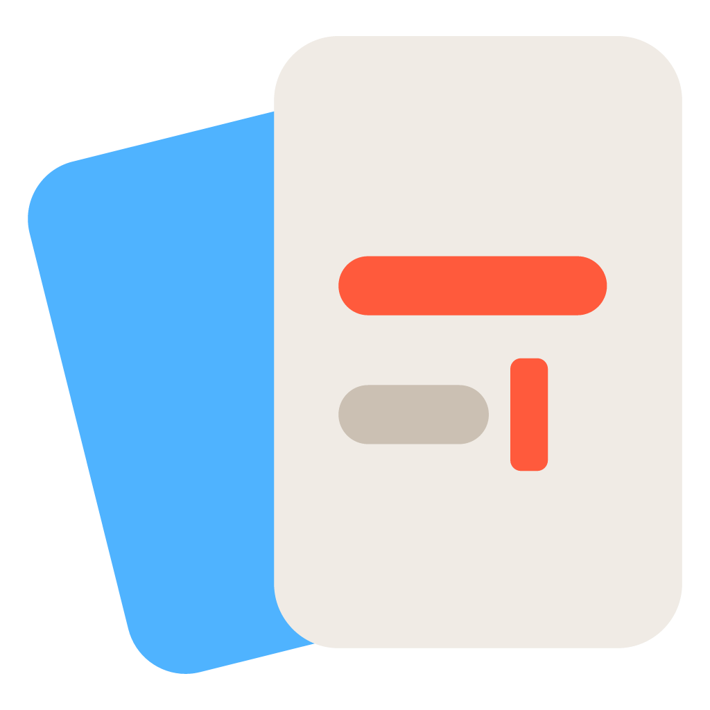
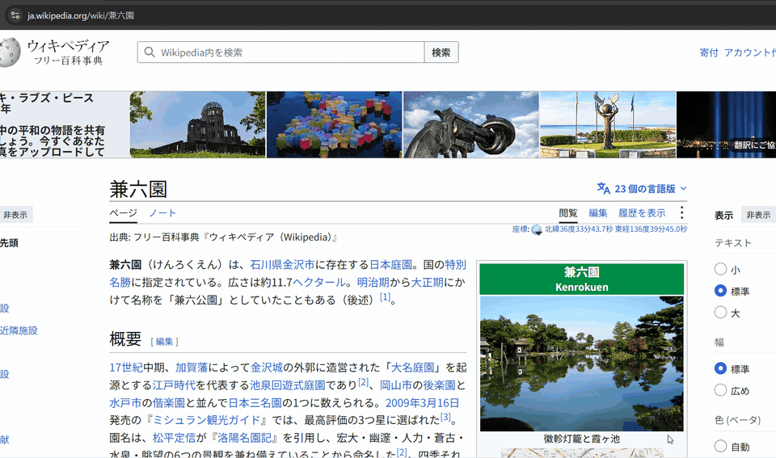

<p align="center">
  
</p>

<h1 align="center">Rmemo</h1>

<p align="center">
  思いついた瞬間に、ホットキーひとつで書きとめる。<br>
  Windows 用のすばやいメモアプリ。
</p>

<p align="center"></p>

## 特徴

- **すぐ書ける** — `Ctrl+N` でどこからでも入力窓が開きます。書いている途中も
  自動保存され、`Ctrl+Enter` で保存してすぐ次のメモを書き始められます。
- **画像の中の文字でも探せる** — 貼ったスクリーンショットの文字を Windows の文字認識で読み取り、
  検索に含めます。読み取りは PC の中だけで行います。日本語も英語も、コードやターミナルの画像も読めます。
- **ローマ字でも探せる** — 検索は、ひらがなとカタカナ、全角と半角、大文字と小文字を区別しません。
  `ringo` と打っても「リンゴ」が見つかります。
- **書き直しても前の版に戻せる** — 編集すると、10 分ごとに直前の内容が履歴に残ります。
  「履歴」（`Ctrl+Shift+H`）から前の版を見て、いつでも戻せます。
- **常駐していても軽い** — 閉じて 10 分たつと画面のメモリを手放し、待っている間は約 10MB
  （メモ 1,000 件のとき）しか使いません。
- **残すメモと使い捨てのメモを分けられる** — 「保管」と「一時」を `Ctrl+L` で切り替え。
  古くなった一時メモは、整理画面で 1 件ずつ「残す / 捨てる」を決められます。
- **書いたそばから整って見える** — 見出し・リスト・チェックボックス・コードブロックなどの
  Markdown を、その場できれいに表示します。日本語入力のままでも使えます。
- **画像・リンク・タグ** — スクリーンショットは `Ctrl+V` で貼るだけ。`[[メモ名]]` でメモ同士をつなぎ、
  `#タグ` で分類できます。
- **エディタとしても本格的** — 複数カーソル、行の移動、見出しの折りたたみ、目次、検索・置換。
- **データはただのテキストファイル** — メモは `Documents\Rmemo` に `.md` ファイルとして保存されます。
  アプリがなくても読めて、Google ドライブなどでそのまま同期できます。

機能の一覧と操作方法は、アプリ内で `F1` を押すと確認できます。

## 動作環境

- Windows 10 / 11（64 ビット）

## インストール

**[Microsoft Store から入手](https://apps.microsoft.com/detail/9n2mdp1460w3?hl=ja-JP&gl=JP)**（おすすめ。アップデートも Store が自動で行います）

インストーラー版を使う場合は、**[Rmemo-setup.exe をダウンロード](https://github.com/hirosugu415/Rmemo/releases/latest/download/Rmemo-setup.exe)** して実行してください
（過去のバージョンは [Releases](https://github.com/hirosugu415/Rmemo/releases) にあります）。

> [!NOTE]
> インストーラー版を初めて実行するときに「Windows によって PC が保護されました」と表示されることがあります。
> 「詳細情報」→「実行」を選ぶとインストールできます。

インストール後はタスクトレイに常駐します。`Ctrl+N` で入力窓が開きます。

## 基本の使い方

すべての画面の詳しい使い方は **[使い方ガイド](https://hirosugu415.github.io/Rmemo/guide.html)** にあります。

| 操作 | キー |
|---|---|
| 入力窓を開く / 閉じる | `Ctrl+N`（設定で変更可） |
| 保存して新しいメモへ | `Ctrl+Enter` |
| 新しいメモ | `Esc` |
| 前回のメモに戻る | `Ctrl+Shift+T` |
| 保管 / 一時 を切り替え | `Ctrl+L` |
| 履歴を見る | `Ctrl+Shift+H` |
| メモを検索 | `Ctrl+Shift+F` |
| 設定 | `Ctrl+,` |
| 使い方 | `F1` |

## データの保存場所

| 内容 | 場所 |
|---|---|
| メモ | `%USERPROFILE%\Documents\Rmemo\keep\` と `scratch\`（設定で変更可） |
| 画像 | 同じフォルダの `assets\` |
| 設定 | `%APPDATA%\Rmemo\` |

アンインストールしても、メモのフォルダは削除されません。

## 複数の PC で同期する

メモの保存フォルダを Google ドライブ内のフォルダに変更すると、複数の PC でメモを共有できます。
手順は [GOOGLE-DRIVE-SYNC.md](GOOGLE-DRIVE-SYNC.md) を見てください。

同期したメモは、スマホのブラウザから閲覧アプリ（ベータ版）で読むこともできます:
<https://hirosugu415.github.io/Rmemo/app/>

## プライバシー

Rmemo はメモを外部に送信しません。メモはすべてあなたの PC 上のファイルとして保存されます。

## 開発者向け

[Tauri 2](https://tauri.app/)（Rust）+ React + CodeMirror 6 で作られています。

必要なもの: [Node.js](https://nodejs.org/) 22 以降、[Rust](https://www.rust-lang.org/)、
[Tauri の前提ソフト](https://tauri.app/start/prerequisites/)

```sh
npm install
npm run tauri dev      # 開発モードで起動
npm test               # テスト
npm run tauri build    # インストーラーを作成（src-tauri/target/release/bundle/）
npm run dev:web        # スマホ用閲覧アプリの開発サーバー
```

## ライセンス

[MIT License](LICENSE)
